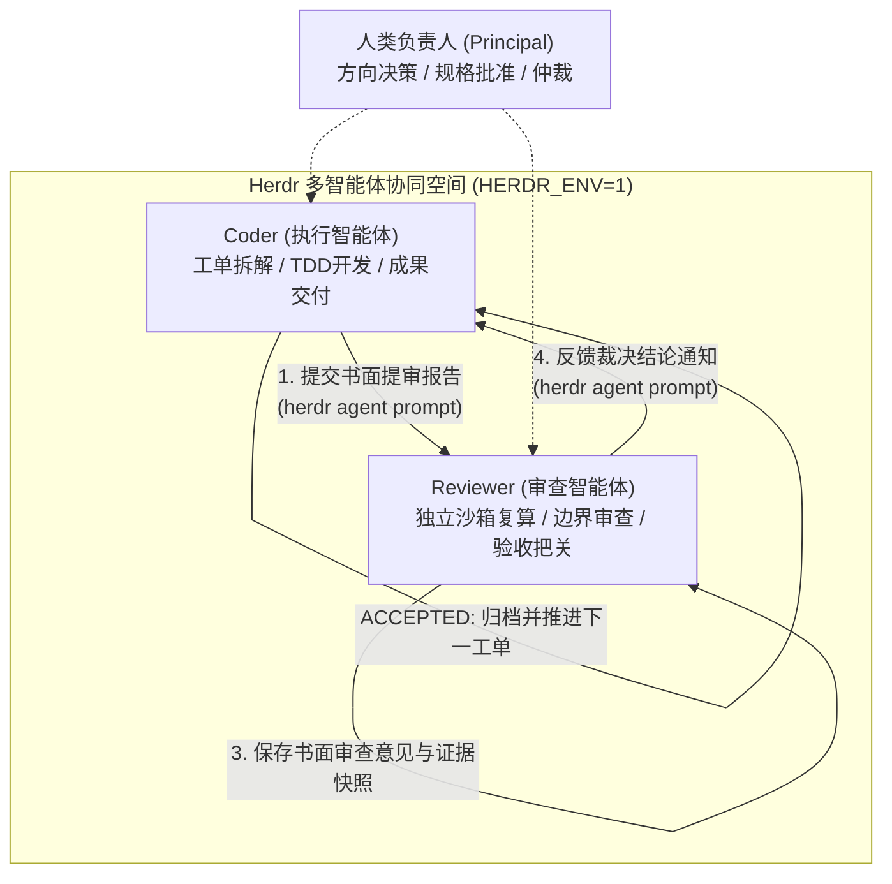
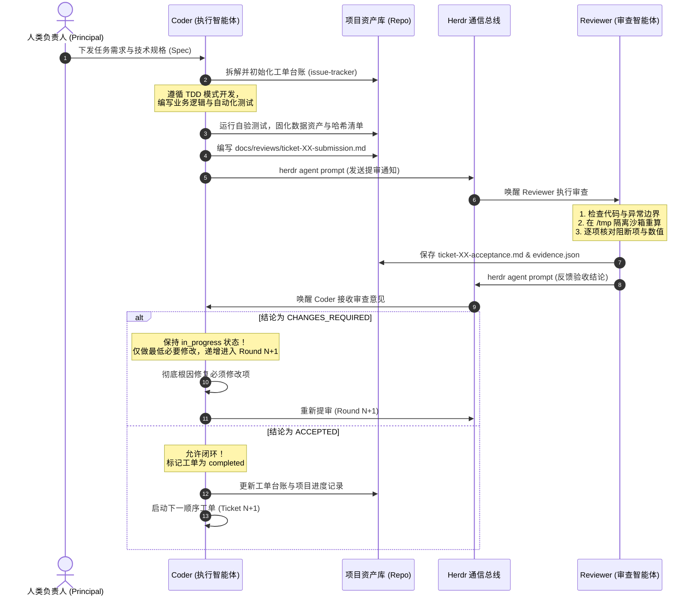

# 基于 Herdr 的 Coder–Reviewer 双智能体协同与工单验收机制规范指南
### (The Coder-Reviewer Dual-Agent Collaboration & Acceptance Guide over Herdr)

> **版本**：v1.2 (通用解耦与跨项目可复现全套工程/数据资产包)  
> **适用场景**：复杂学术实证研究、大规模数据清洗与分析、高可靠性软件工程及多智能体长期协作项目  
> **核心基础设施**：[Herdr](https://herdr.dev) 多智能体终端与工作区管理器  
> **协作角色矩阵**：人类负责人 (Human Principal) + 执行智能体 (Agent Coder) + 审查智能体 (Agent Reviewer)

---

## 🗂️ 仓库通用资产导航 (Repository Assets Matrix)

本仓库提供从协作方法论、流程控制台账到可复现工程/数据工具的端到端开箱即用支持：

| 模块类别 | 文件/目录路径 | 核心功能与复用定位 |
| :--- | :--- | :--- |
| **协作规范指南** | [`README.md`](./README.md) / [`CODER_REVIEWER_HERDR_COLLABORATION_GUIDE.md`](./CODER_REVIEWER_HERDR_COLLABORATION_GUIDE.md) | 双智能体权力分立、两铁律、Herdr 动态通信协议与 SOP 全流程指南 |
| **标准写作流** | [`论文写作workflow v1 1014.txt`](./论文写作workflow%20v1%201014.txt) / [`templates/paper_writing_workflow.txt`](./templates/paper_writing_workflow.txt) | 顶级学术期刊 (Research Policy / Evaluation) 标准的论文各章节写作与审查 8 步工作流 |
| **落地协作规则** | [`templates/AGENTS.md`](./templates/AGENTS.md) | 新项目直接复制到根目录，立即生效三权分立与不可逾越两铁律 |
| **工单追踪台账** | [`templates/issue-tracker.md`](./templates/issue-tracker.md) | 新项目工单拓扑依赖图、状态机流转（`pending`/`in_progress`/`completed`）模板 |
| **标准提审报告** | [`templates/review_submission_template.md`](./templates/review_submission_template.md) | Coder 提审标准 Markdown 骨架（对账前轮阻断项、测试数据证据） |
| **标准验收意见** | [`templates/review_acceptance_template.md`](./templates/review_acceptance_template.md) | Reviewer 独立复核标准 Markdown 骨架（沙箱复验凭证、必须修改项） |
| **通用工具：分发打包** | [`tools/build_distribution_zip.py`](./tools/build_distribution_zip.py) | 跨平台零乱码科研分发包构建工具（强制启用 PKZIP UTF-8 Bit 11，过滤垃圾缓存） |
| **通用工具：学术排版** | [`tools/beautify_academic_docx.py`](./tools/beautify_academic_docx.py) | 出版级学术 Word 终稿排版器（A4学术版式、标准三线表重塑、中西文字体分离注入） |
| **通用工具：防幻断言** | [`tools/verify_grounding_assertions.py`](./tools/verify_grounding_assertions.py) | 大模型信息抽取原文物理字符切片硬断言校验器（`source[start:end] == quote`） |
| **通用工具：守恒审计** | [`tools/audit_multiset_integrity.py`](./tools/audit_multiset_integrity.py) | 大规模数据流水线多重集守恒与分母闭合审计器（$N_{\text{raw}} = N_{\text{valid}} + N_{\text{excluded}}$） |
| **工具箱使用手册** | [`tools/README.md`](./tools/README.md) | 工具箱依赖说明、命令行参数与各场景最佳实践指南 |

---


## 一、体系背景与核心设计哲学

在利用大语言模型（LLM）执行长周期、高精度的学术实证或复杂工程任务时，单智能体（Single-Agent）架构往往面临三大固有困境：
1. **自我放水与伪验证（Self-Serving Bias）**：编写代码的智能体同时负责测试自评，极易产生循环自证、构造虚假测试用例或降低断言阈值以求“过关”；
2. **幻觉漂移与长上下文遗忘（Contextual Drift）**：随着交互轮次剧增，单一智能体会悄然偏离最初的研究设想、规格指南与严格边界；
3. **闭环自欺（Premature Convergence）**：在遇到复杂长链条阻断时，倾向于使用“硬编码模拟数据”、“默认放行”或“机械跳过”等假动作蒙混过关。

为了从根本上消除上述弊端，本机制确立了**“权力分立、相互制约、逐单把关、真实存证”**的协作架构：
- **生产与验收逻辑解耦**：由**执行智能体（Coder）**负责方案实施、代码编写、数据处理与产物交付；由独立的**审查智能体（Reviewer）**负责防御性反例测试、代码审计与独立沙箱验收；由**人类负责人（Principal）**把控宏观方向、批准研究规范并对重大分歧实施终局仲裁；
- **通信总线解耦**：依托 **Herdr** 终端管理器实现 Coder 与 Reviewer 两个独立会话/窗格之间的动态寻址与跨进程结构化通信，互不干扰上下文；
- **全过程留痕审计**：每一轮提审与审查均沉淀正式的书面报告与机器可读证据快照，杜绝口头协议与无据推进。



---

## 二、角色定义与权责边界（模型不可知设计）

本框架在设计上实现**模型不可知（Model-Agnostic）**。只要支持终端交互或 API 调用的现代大语言模型，均可按能力特征灵活指派对应角色：

| 角色 | 能力特征与推荐选型 | 核心权责与分工 | 严谨边界与红线 |
| :--- | :--- | :--- | :--- |
| **人类负责人<br>(Principal)** | 人类研究员 / 架构师 | 1. 确立研究设想与核心元命题；<br>2. 批准项目研究指南与技术规格（Spec）；<br>3. 遇到不可调和的技术分歧时出面终局裁决。 | 授权 Coder 与 Reviewer 自主推进日常工单循环，不陷入微观琐碎沟通。 |
| **执行智能体<br>(Coder)** | 强调强大的工程吞吐、工具调用与长程代码构建能力。<br>*典型选型：Claude 3.7 Sonnet / Gemini 2.5 Pro / GPT-4o 等* | 1. 依据 Spec 将任务拆解为可追踪工单（Tickets）；<br>2. 遵循 TDD 测试驱动开发与最小改动原则；<br>3. 撰写标准化书面提审报告（Submission Report）；<br>4. 修复 Reviewer 指出的阻断项并逐轮返修。 | **自评通过 $\neq$ 验收通过**；<br>严禁未经 Reviewer 明确书面批准擅自将工单标记为已完成。 |
| **审查智能体<br>(Reviewer)** | 强调深度逻辑推理、长思维链反例挖掘与严格批判性思维。<br>*典型选型：OpenAI o1/o3 / DeepSeek-R1 / Claude 3.7 (Thinking) 等* | 1. 独立审查代码逻辑、输入输出完整性与异常边界；<br>2. 在全新临时沙箱目录（如 `/tmp`）中重放核心计算与断言校验；<br>3. 出具书面审查意见（Acceptance Report）与证据快照；<br>4. 区分阻断项与可选建议，说明最低必要修改。 | **不代替 Coder 重新设计整个任务**；<br>尊重 Coder 创意与具体措辞，不以个人风格偏好阻碍验收。 |

---

## 三、不可逾越的两大协作铁律

### 铁律一：工单逐一执行与逐单必审 (Serial Execution & Mandatory Review)
- **逐一推进**：所有开发与研究任务必须拆解为编号工单（如 `Ticket-01`, `Ticket-02`...），**必须严格按前置依赖顺序逐一完成，严禁批量跨工单闭环**；
- **逐单提审**：每个工单编码及自验完成后，必须立即准备正式的书面提审材料，向 Reviewer 提交独立审查；
- **单单通过方可前行**：唯有当 Reviewer 出具明确的 `ACCEPTED` 书面结论后，Coder 才能将该工单标记为已完成（`completed`），并启动下一个工单。

### 铁律二：严禁擅自闭环 (Prohibition of Premature / Self-Closure)
- **审查未通过不得关单**：若 Reviewer 出具 `CHANGES_REQUIRED`（退回待修正），工单必须强制保持 `in_progress` 状态；
- **彻底修复拒绝糊弄**：Coder 必须深入排查 Reviewer 报告中列出的必须修改项（Must-fix），做彻底的根因修复，不得通过降低断言阈值、删除测试或硬编码假结果绕过；
- **闭环迭代直到通过**：修复完成后，递增轮次重新提交复审（Round 1 $\to$ Round 2 $\to$ Round 3...），直至 Reviewer 明确出具 `ACCEPTED`。

---

## 四、审查尺度与把关原则

Reviewer 的职责是把守质量底线与科学严谨性，而非挑刺阻碍工程推进。为此确立以下审查原则：

### 1. 严格区分“必须修改项（阻断项）”与“可选建议项（非阻断）”
- **必须修改项（Must-fix / Blocking）**：
  - 影响研究方向或结论真实性的事实错误（如未计算数值写成具体百分比、倒果为因）；
  - 代码逻辑漏洞、边界条件未覆盖、抛出未捕获异常或依赖未声明；
  - 数据资产丢失、多重集计数不匹配、虚假断言放行、密码学哈希不一致；
  - 格式严重遮挡、关键指标缺失导致图表或交付物失真。
- **可选建议项（Optional / Non-blocking）**：
  - 个人文字风格、用词习惯、色彩美学偏好；
  - 非阻断性的边角文字排版、微小留白间距建议；
  - 既有历史通过结论中已明确豁免的细节。

### 2. 最低必要修改原则 (Minimum Necessary Modification)
- Reviewer 审查意见必须清晰说明：**实际问题是什么**、**带来什么严重后果**、以及**最低必须做到什么程度即可验收**；
- 审查者不得随意推翻已确认的研究范式或要求 Coder 重新推倒重来；历史方案及讨论建议不自动成为新的验收条件。

### 3. 独立隔离沙箱复验原则 (Isolated Sandbox Re-execution)
- Reviewer 不得仅凭静态阅读代码或轻信 Coder 的控制台打印日志；
- Reviewer 必须在**独立的临时目录**（如 `/tmp/sandbox-review-*`）中运行 Coder 的脚本或测试套件，独立捕获产物并核对哈希与数值。

---

## 五、基于 Herdr 的跨智能体通讯协议

在配备 Herdr 的多智能体工作区中，通信必须遵循以下标准化流程：

### 1. 环境准备与动态目标探测
严禁凭历史窗格编号或固定终端标签猜测对方身份，每次通信前必须动态检测：

```bash
# 1. 验证 Herdr 环境激活
test "${HERDR_ENV:-}" = 1 || exit 1

# 2. 列出当前活动窗格与智能体，动态获取目标 pane_id
herdr pane list
# 或
herdr agent list
```
在输出的 JSON 数据中，根据 `cwd`（工作目录）与 `agent` / `label` 字段精准锁定 Coder 与 Reviewer 的动态 `pane_id`（例如：Coder 窗格为 `<PANE_CODER>`，Reviewer 窗格为 `<PANE_REVIEWER>`）。

---

### 2. Coder $\to$ Reviewer：标准提审通知规范
Coder 提审前，必须先在 `docs/reviews/` 目录下保存书面提审报告（`ticket-<ID>-submission-round<N>.md` 并同步 `ticket-<ID>-submission.md`），随后调用 Herdr 发送结构化通知：

```bash
herdr agent prompt <PANE_REVIEWER> "【工单提审通知】
- 工单/材料：<工单编号与名称>（例如：Ticket-03 数据清洗管道与多重集守恒审计）
- 提审轮次：第 <N> 轮提审 (Round <N>)
- 提审报告路径：docs/reviews/ticket-<ID>-submission-round<N>.md（已同步 ticket-<ID>-submission.md）
- 变更范围与成果路径：<主要交付文件清单>
- 前轮阻断项闭环对账：
  1. <阻断项1标识>：<修复落地说明>
  2. <阻断项2标识>：<修复落地说明>
- 核心核验指标：<单元测试通过数 / 抽样准确率 / 数据哈希比对结果>
请开展独立复审验收，重点复核前轮剩余阻断项！"
```

---

### 3. Reviewer $\to$ Coder：标准审查完成通知规范
Reviewer 审查完成后，**必须先保存书面审查意见（`ticket-<ID>-acceptance-round<N>.md`）和证据快照（`ticket-<ID>-review-evidence-round<N>.json`），再使用 Herdr 通知 Coder**。通过与不通过均须通知：

```bash
herdr agent prompt <PANE_CODER> "【工单审查完成通知】
- 工单/材料：<工单编号与名称>
- 审查轮次：第 <N> 轮独立复审 (Round <N>)
- 明确裁决结论：[ ACCEPTED / CHANGES_REQUIRED ]
- 书面审查报告：docs/reviews/ticket-<ID>-acceptance-round<N>.md（已同步 ticket-<ID>-acceptance.md）
- 独立复验凭证：docs/reviews/ticket-<ID>-review-evidence-round<N>.json
- 验收结论概述：<已确认通过的核心工程与数据指标>
- 剩余必须修改项 (若未通过)：
  1. <阻断项标识>：<实际问题与最低必要修改>
- 下轮复核范围：仅复核上述必须修改项，不重做已通过分支。"
```

---

## 六、工单全生命周期操作标准流程 (SOP)



### 步骤详解：

1. **工单定义与追踪（Issue Tracking）**：
   - 在项目规范路径维护工单列表（如 `docs/agents/issue-tracker.md` 或通用 Issue 系统）；
   - 严格标注工单状态：`pending`（待办）、`in_progress`（在办/返修中）、`completed`（验收通过）、`superseded`（已废弃）。
2. **TDD 驱动与自验（Red-Green-Refactor）**：
   - 编写针对工单任务的单元测试与断言；
   - 运行并确保全套测试 100% 绿色通过；
   - 检查控制台输出，确保零未捕获异常、零语法废弃告警（SyntaxWarning）。
3. **编写书面提审报告（Submission Artifact）**：
   - 归档路径：`docs/reviews/ticket-<ID>-submission-round<N>.md`，并拷贝覆盖 `docs/reviews/ticket-<ID>-submission.md`；
   - 报告必须包含：对应研究/工程目的、变更文件列表、对前轮审查意见的逐条对账、已有自检结果及已知推论边界。
4. **发起提审并等待通知**：
   - 通过 Herdr 发送提审 Prompt；
   - 发送后 Coder 停止轮询，挂起等待（Reactive Wakeup），由系统消息或 Herdr 唤醒。
5. **Reviewer 独立复核与证据存证**：
   - Reviewer 在独立沙箱调用关键函数或隔离重建；
   - 收集重算结果、散列哈希值与度量指标，存入 `docs/reviews/ticket-<ID>-review-evidence-round<N>.json`；
   - 编写审查报告并保存于 `docs/reviews/ticket-<ID>-acceptance-round<N>.md`，同步至 `ticket-<ID>-acceptance.md`；
   - 通过 Herdr 发送带明确结论的裁决通知。
6. **处置裁决结果**：
   - **通过（ACCEPTED）**：Coder 更新工单状态为 `completed`，同步项目文档与进度记录；
   - **退回（CHANGES_REQUIRED）**：工单维持 `in_progress`，严禁擅自合入或关闭。Coder 针对 Reviewer 列出的最小必要修改项做靶向修复，修复后开启下一轮提审。

---

## 七、数据工程与学术科研的通用防线规范

针对数据密集型流水线、AI 抽取、计量统计与论文生成等高精度场景，提审与审查必须严格遵守以下四道硬防线：

### 1. 全量输入输出多重集对账（Multiset Integrity & Denominator Accounting）
- 审查涉及全量数据处理的工单时，**必须验证输入唯一键集合与输出唯一键集合的多重集完全一致**（无缺失、无重复、无静默丢弃、无顺序错位）；
- 必须明确全量样本分母的去向与数学守恒闭环：
  $$\text{全量输入样本 } N = \text{有效处理集合 } N_{\text{valid}} + \text{显式合法排除集合 } N_{\text{excluded}}$$
  分母流向必须 100% 可解释、可审计，严禁静默过滤。

### 2. 真实物理字符坐标切片断言（Physical Quote Grounding）
- 任何从源文本中提取的构念、命题、实体或因果链条，提取记录必须附带原始文本中的字符级绝对切片坐标（`[char_start, char_end]`）；
- 抽样核验时，必须执行硬断言校验：
  $$\text{source\_text}[char\_start:char\_end] == extracted\_quote$$
- 严禁模糊匹配、空字符串放行或回退至 `[0, len(text))` 等弱化校验行为。

### 3. 密码学哈希清单与资产版本化（Cryptographic Manifest）
- 关键交付资产（数据集、分类体系、模型权重、中间矩阵、质检报告）必须计算 SHA-256 哈希值与文件字节大小，固化于 `manifest.json`；
- 下游消费端读取资产时，必须首先校验证书清单，哈希不符立即抛出异常并阻断运行，防止上游数据被原地悄然篡改或截断。

### 4. 杜绝硬编码伪共识与虚构伪造（Anti-Mocking & Anti-Hallucination）
- 动态绘图与统计分析代码必须动态读取正式已验收的持久化数据资产，严禁在脚本中手写固定数组伪造“动态读取”；
- 涉及模型交叉审核的流程，必须保留官方真实的 API `request_id` 与完整往返时间戳存证，杜绝本地伪造的假审核；
- 论文正文与报告坚决杜绝任何未经验证的虚构参考文献（Fake Citations），无确切权威出处一律删除或存真。

---

## 八、新项目快速落地与配置检查清单 (Checklist)

在任何新仓库中建立此套协作机制，只需执行以下 5 步：

- [ ] **1. 初始化项目协作规则文件**：
  在项目根目录创建 `AGENTS.md`，声明 Principal、Coder 与 Reviewer 身份，载入“工单逐一执行与逐单必审”和“严禁擅自闭环”两项铁律。（参见附录 A）
- [ ] **2. 建立审查记录目录结构**：
  创建目录 `docs/reviews/`，约定所有提审报告（`*-submission*.md`）、验收报告（`*-acceptance*.md`）及证据快照（`*-review-evidence*.json`）统一归档于此。
- [ ] **3. 建立工单任务追踪台账**：
  创建 `docs/agents/issue-tracker.md`，将整体规划拆解为编号工单，明确输入、输出与依赖前置。（参见附录 B）
- [ ] **4. 配置 Herdr 多窗格终端**：
  启动 Herdr 会话，分配两个专职窗格并分别启动 Coder 与 Reviewer 终端，通过 `herdr pane list` 验证二人状态正常。
- [ ] **5. 执行首个工单闭环试运行**：
  Coder 执行 Ticket-01 $\to$ 编写测试通过 $\to$ 编写提交报告 $\to$ 通过 Herdr 提审 $\to$ Reviewer 隔离沙箱复验 $\to$ Reviewer 落盘意见并通过 Herdr 反馈 $\to$ 闭环推进。

---

## 附录 A：通用 `AGENTS.md` 开箱即用模板

新项目根目录可直接拷贝使用以下模板：

```markdown
# 项目智能体协作与验收规则 (AGENTS.md)

本规则适用于本项目后续所有设计、开发、数据分析与材料交付工作。

## 1. 角色分工
- **Principal (人类负责人)**：负责提出核心需求设想，批准任务规范 (Spec)，在出现重大分歧时进行终审裁决；
- **Coder (执行智能体)**：负责方案设计、代码编写、数据处理、测试覆盖与材料交付；
- **Reviewer (审查智能体)**：负责独立代码审查、异常边界测试、沙箱重放验证与验收把关。

## 2. 核心铁律
1. **工单逐一执行与逐单必审**：
   - 必须按依赖顺序逐一完成工单；
   - 每个工单完成后必须提交 Reviewer 审核；
   - 经 Reviewer 明确书面审核通过（ACCEPTED）后才能启动下一个工单。
2. **严禁擅自闭环**：
   - Reviewer 审核未通过（CHANGES_REQUIRED），不得自行关闭工单或标记为已完成（completed）；
   - 必须彻底修复 Reviewer 指出的必须修改项并重新提审，直至 Reviewer 明确验收通过；
   - 自评通过、测试通过或运行成功不等于验收通过，必须以 Reviewer 的书面验收结论为准。

## 3. 通信与通知规范
- 双方依托 Herdr 终端总线通讯，发送通知前通过 `herdr pane list` 动态确认对方 pane 身份；
- 提审前 Coder 必须在 `docs/reviews/` 归档书面提审报告；
- 审查完成后 Reviewer 必须先保存书面审查意见和证据快照，再通过 Herdr 发送裁决通知。
```

---

## 附录 B：通用 `issue-tracker.md` 工单台账模板

```markdown
# 项目工单执行追踪总账 (issue-tracker.md)

## 工单依赖图拓扑
\`\`\`mermaid
flowchart TD
    T01["Ticket-01: 环境配置与基础输入校验"] --> T02["Ticket-02: 核心业务处理流水线"]
    T02 --> T03["Ticket-03: 数据资产生成与多重集审计"]
    T03 --> T04["Ticket-04: 综合统计分析与可视化交付"]
\`\`\`

## 活动工单清单

| 工单编号 | 工单名称 | 负责人 | 当前状态 | 阻塞依赖 | 最新审查报告 |
| :--- | :--- | :--- | :--- | :--- | :--- |
| **Ticket-01** | 环境配置与基础输入校验 | Coder | `completed` | 无 | `docs/reviews/ticket-01-acceptance.md` |
| **Ticket-02** | 核心业务处理流水线 | Coder | `in_progress` | Ticket-01 | `docs/reviews/ticket-02-submission.md` |
| **Ticket-03** | 数据资产生成与多重集审计 | Coder | `pending` | Ticket-02 | - |
| **Ticket-04** | 综合统计分析与可视化交付 | Coder | `pending` | Ticket-03 | - |
```

---

## 附录 C：Herdr 终端跨智能体通讯速查 (Cheat Sheet)

```bash
# 1. 检查 Herdr 环境
echo $HERDR_ENV   # 应输出 1

# 2. 列出活动窗格并过滤 JSON
herdr pane list

# 3. 发送结构化提审/通知 (非阻塞唤醒目标窗格)
herdr agent prompt <TARGET_PANE_ID> "通知消息正文"

# 4. 捕获指定窗格的最近屏幕输出 (用于辅助状态排查)
herdr pane capture <TARGET_PANE_ID> --lines 50
```
