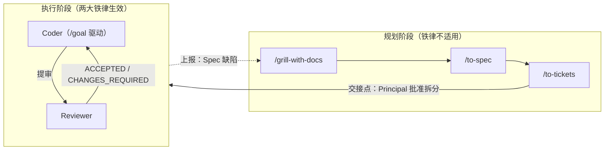
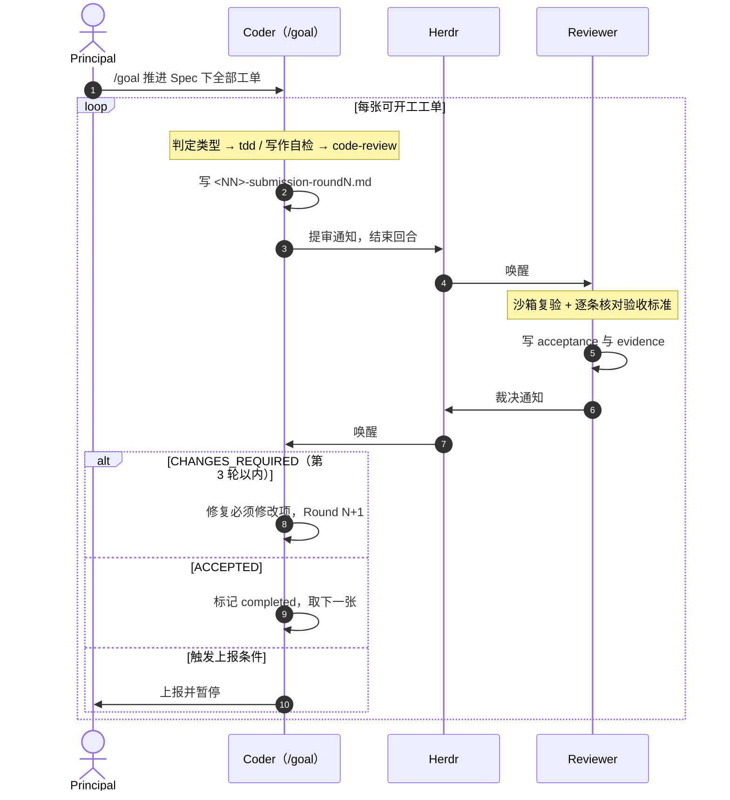

# 基于 Herdr 的 Coder–Reviewer 双智能体协同与工单验收机制规范指南
### (The Coder-Reviewer Dual-Agent Collaboration & Acceptance Guide over Herdr)

> **版本**：v2.0（规划 / 执行两阶段，执行阶段由 `/goal` 驱动）  
> **适用场景**：复杂学术实证研究、大规模数据清洗与分析、高可靠性软件工程、学术论文修改等长期多智能体协作项目  
> **核心基础设施**：[Herdr](https://herdr.dev) 多智能体终端与工作区管理器；规划阶段技能 `grill-with-docs` / `to-spec` / `to-tickets`  
> **协作角色**：人类负责人 (Principal) + 执行智能体 (Coder) + 审查智能体 (Reviewer)  
> **术语**：见仓库根目录 [`GLOSSARY.md`](../../GLOSSARY.md)；两阶段设计的来由见 [ADR-0001](../adr/0001-规划与执行两阶段分离.md)

本指南是框架的唯一完整说明。可直接复制到项目里的规则文件是 [`templates/project/AGENTS.md`](../../templates/project/AGENTS.md)（随 `templates/project/` 骨架整体复制），二者冲突时以 `AGENTS.md` 为准并修正本指南。

---

## 一、设计哲学

单智能体执行长周期、高精度任务时有三种典型失败：
1. **自我放水**：写代码的 agent 自己评估自己，容易构造虚假测试、降低断言阈值以求过关；
2. **上下文漂移**：交互轮次一多，就偏离最初的设想与边界；
3. **闭环自欺**：遇到困难时用硬编码数据、默认放行或跳过来蒙混过关。

对策是**生产与验收分离**：Coder 负责实现，独立的 Reviewer 负责沙箱复验与验收，Principal 负责方向与仲裁。两者通过 Herdr 在不同窗格中通信，上下文互不干扰；每一轮提审与验收都落成书面记录。

但**分离只适用于执行**。确定要做什么（Spec）是 Principal 与 agent 的对话，无法"提审"。因此框架分为两个阶段：



---

## 二、角色与权责

| 角色 | 规划阶段 | 执行阶段 | 红线 |
| :--- | :--- | :--- | :--- |
| **Principal** | 与 agent 一起 grill，产出 Spec；在 `/to-tickets` 中批准拆分方案 | 用 `/goal` 启动 Coder；只处理上报 | 不陷入日常工单的微观沟通 |
| **Coder** | （可由同一 agent 担任规划对话方） | 逐张实现工单、自检、提审、按裁决返修 | 自评通过 ≠ 验收通过；不得自行把工单标为 `completed` |
| **Reviewer** | 不参与 | 独立复核每一轮提审，出具书面裁决与证据 | 不替 Coder 重新设计；不以风格偏好阻碍验收 |

框架不依赖特定模型。Coder 适合工程吞吐与工具调用能力强的模型，Reviewer 适合推理深、批判性强的模型。

---

## 三、规划阶段

1. **`/grill-with-docs`**：Principal 与 agent 逐轮澄清需求，同时沉淀 `GLOSSARY.md` 与 ADR。此时**不需要任何已有 Spec**。
2. **`/to-spec`**：把对话综合成 Spec，发布到项目 tracker。
3. **`/to-tickets`**：把 Spec 拆成垂直切片工单，每张都写明前置工单和验收标准。Principal 审核粒度与依赖关系。
4. **交接点**：Principal 批准拆分方案、工单发布后，规划阶段结束。

规划阶段不建工单、不提审、不经过 Reviewer。

> 学术论文修改可以使用预制骨架：[`templates/academic_paper_workflow.md`](../../templates/academic_paper_workflow.md)。grill 目标期刊与修改重点后，`/to-tickets` 以它的【1】–【7】为骨架拆分。

---

## 四、执行阶段的两大铁律

### 铁律一：逐单必审
- 一张工单只有在其**所有前置工单都已 `completed`** 后才能开工；
- 每张工单完成后必须单独提审；
- Coder 同一时间只处理一张工单（详见 ADR-0001）。

### 铁律二：严禁擅自闭环
- 只有 Reviewer 的书面 **ACCEPTED** 能让工单变为 `completed`；自测、`code-review`、运行成功都不算；
- **CHANGES_REQUIRED** 时工单保持 `in_progress`，Coder 做根因修复，不得降低断言、删除测试或硬编码结果，然后递增轮次重新提审。

---

## 五、用 `/goal` 驱动执行

Principal 在 Coder 窗格中发出一条 goal，例如：

```
/goal 你是本项目的 Coder。按 AGENTS.md 执行阶段规则，推进 Spec <链接> 下的全部工单，直至全部 completed 或需要上报。
```

Reviewer 窗格不会从 goal 得知自己的角色，因此每次新开 Reviewer 会话都要先发启动语：

```
你是本项目的 Reviewer。按 AGENTS.md 第 7 节工作，等待 Herdr 的【提审】通知后开始复核；未收到通知时不做任何事。
```

单张工单的步骤、等待规则与上报条件都写在 `AGENTS.md` 里，所以 goal 指令保持很短，并在 Claude Code、pi、Codex 之间通用。注意：`/implement`、`/implement-spec` 都设置了 `disable-model-invocation`，goal 模式下 Coder 无法自行调用；`implement-spec` 还会自动关单，违反铁律二，因此执行阶段不使用它们。

### 1. 单张工单的循环
1. 选一张可开工的工单（前置工单全部 `completed`，多张时取编号最小者），状态改为 `in_progress`；
2. 判定**工单类型**并执行：
   - **代码**：调用 `tdd`；
   - **数据**：调用 `tdd`，并满足第八节的数据防线；
   - **写作**：按验收标准与写作规范修改，逐条自检；
3. 代码和数据工单调用 `code-review` 自检并修复；
4. 写提审报告，用 Herdr 通知 Reviewer，**结束回合**。

### 2. 等待
提审后 Coder 不开新工单，也不自行判断是否通过。被 goal 续跑唤醒时，只检查本轮验收报告是否存在；不存在就再次结束回合。这是 goal 模式下最容易出问题的地方：续跑会打断"等待"，让 agent 自作主张往下推进。

### 3. 处理裁决
- **ACCEPTED**：改为 `completed`，进入下一张工单；
- **CHANGES_REQUIRED**：只修必须修改项，以 Round N+1 重新提审；
- **goal 完成条件**：当前 Spec 下全部工单为 `completed` 或 `superseded`。

### 4. 上报 Principal
遇到以下任一情况，Coder 停止推进并通知 Principal：
- 同一工单第 3 轮仍为 CHANGES_REQUIRED；
- Coder 不认可某个必须修改项；
- 发现 Spec 或工单本身有缺陷。

Spec 缺陷的处理回路：Principal 回到规划阶段，只针对缺陷修订 Spec → `/to-tickets` 重新生成受影响且未 `completed` 的工单 → 被替换的旧工单标为 `superseded` → 重新发出 `/goal`。已 `completed` 的工单默认不重开。



---

## 六、审查尺度

### 1. 验收依据
主检查清单是**工单的验收标准**加 **Spec 相关条目**。数据防线只在数据工单中强制检查。Reviewer 复核 Coder 声明的工单类型，判定有误时列为必须修改项。

### 2. 必须修改项与可选建议
- **必须修改项**：事实或数值错误、逻辑漏洞、边界未覆盖、未声明依赖、数据丢失或计数不符、虚假断言放行、交付物失真、未满足验收标准；
- **可选建议**：文字风格、用词、排版、配色等偏好，以及已明确豁免的细节。

### 3. 最低必要修改
每个必须修改项都要写明实际问题、后果，以及最低改到什么程度即可通过。不得推翻已确认的方案或要求推倒重来；历史讨论中的建议不会自动成为新的验收条件。

### 4. 沙箱复验
Reviewer 不能只看代码或只信 Coder 的日志，必须在独立临时目录（如 `/tmp/sandbox-review-*`）重新运行测试与关键计算。

---

## 七、Herdr 通信与评审记录

### 1. 动态寻址
每次通知前先确认环境与对方窗格，不要凭旧的 pane 编号猜测：

```bash
test "${HERDR_ENV:-}" = 1 || exit 1
herdr pane list        # 根据 cwd 与 agent/label 字段确定 <PANE_CODER> / <PANE_REVIEWER>
```

### 2. 评审记录目录
```
docs/reviews/
├── submission-template.md        ← 来自 templates/project/ 骨架
├── acceptance-template.md        ← 来自 templates/project/ 骨架
└── <spec-slug>/
    ├── 01-submission-round1.md
    ├── 01-acceptance-round1.md
    ├── 01-evidence-round1.json
    └── ...
```
`/to-tickets` 的编号在每个 Spec 内都从 01 开始，所以要按 Spec 分目录。不保留不带轮次的副本，最新一轮就是编号最大的那一轮。

### 3. 通知格式
通知只是指针，详细内容都写在报告文件里：

```bash
# Coder → Reviewer（先保存提审报告）
herdr agent prompt <PANE_REVIEWER> "【提审】<spec-slug>/<NN> <工单标题> Round <N>，类型：<代码/数据/写作>，报告：docs/reviews/<spec-slug>/<NN>-submission-round<N>.md"

# Reviewer → Coder（先保存验收报告与证据）
herdr agent prompt <PANE_CODER> "【裁决】<spec-slug>/<NN> Round <N>：<ACCEPTED/CHANGES_REQUIRED>，报告：docs/reviews/<spec-slug>/<NN>-acceptance-round<N>.md"
```

辅助排查：`herdr pane capture <PANE_ID> --lines 50`。

---

## 八、数据防线（数据工单强制）

### 1. 多重集守恒与分母闭合
输入与输出的唯一键多重集必须对得上，不得有缺失、重复或静默丢弃：
$$N = N_{\text{valid}} + N_{\text{excluded}}$$
工具：[`tools/audit_multiset_integrity.py`](../../tools/audit_multiset_integrity.py)。

### 2. 字符切片硬断言
抽取的每一条记录都要附 `[char_start, char_end]`，并通过 `source_text[char_start:char_end] == extracted_quote` 校验。不允许模糊匹配、空串放行，也不允许回退成整段文本。工具：[`tools/verify_grounding_assertions.py`](../../tools/verify_grounding_assertions.py)。

### 3. SHA-256 资产清单
关键资产的 SHA-256 与字节数写入 `manifest.json`；下游读取前先校验，不一致立即中止。

### 4. 反伪造
绘图与统计必须读取已验收的持久化资产，不得手写数组冒充"动态读取"；模型交叉审核保留真实的 `request_id` 与时间戳；不得出现无法核验的参考文献。

---

## 九、新项目落地清单

- [ ] 1. 复制项目骨架：`cp -rn templates/project/. <项目根目录>/`。这会放入 `AGENTS.md`、`CLAUDE.md`（内容为 `@AGENTS.md`，因为 Claude Code 只读 `CLAUDE.md`）`docs/reviews/` 下的两份评审模板，以及给人看的操作说明 `docs/agents/collaboration-quickstart.md`，路径与 `AGENTS.md` 的引用一致。若项目已有 `AGENTS.md`/`CLAUDE.md`，`-n` 会跳过它们，需要手工合并。
- [ ] 2. 运行 `/setup-matt-pocock-skills`，配置 tracker（本地 `.scratch` 或 GitHub 等）。
- [ ] 3. 启动 Herdr，开两个窗格分别运行 Coder 与 Reviewer，用 `herdr pane list` 确认，并在 Reviewer 窗格发出启动语（见第五节）。
- [ ] 4. 规划阶段：`/grill-with-docs` → `/to-spec` → `/to-tickets`，批准拆分方案。
- [ ] 5. 执行阶段：在 Coder 窗格发出 `/goal`，观察第一张工单走完一次完整的提审与验收闭环。
- [ ] 6. （可选）用 `templates/issue-tracker.md` 维护给人看的工单索引。
