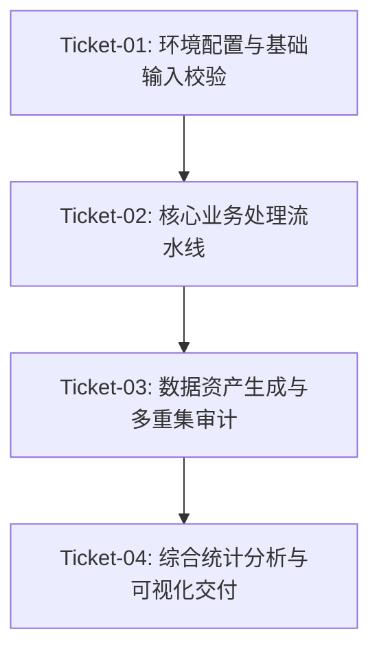

# 项目工单执行追踪总账 (issue-tracker.md)

## 工单依赖图拓扑

## 活动工单清单

| 工单编号 | 工单名称 | 负责人 | 当前状态 | 阻塞依赖 | 最新审查报告 |
| :--- | :--- | :--- | :--- | :--- | :--- |
| **Ticket-01** | 环境配置与基础输入校验 | Coder | `completed` | 无 | `docs/reviews/ticket-01-acceptance.md` |
| **Ticket-02** | 核心业务处理流水线 | Coder | `in_progress` | Ticket-01 | `docs/reviews/ticket-02-submission.md` |
| **Ticket-03** | 数据资产生成与多重集审计 | Coder | `pending` | Ticket-02 | - |
| **Ticket-04** | 综合统计分析与可视化交付 | Coder | `pending` | Ticket-03 | - |

## 工单状态机说明
- `pending`：待办（前置工单未就绪或尚未启动）
- `in_progress`：正在执行或返修中（包含提审中及 CHANGES_REQUIRED 状态）
- `completed`：已闭环（经 Reviewer 独立复核并明确出具 ACCEPTED 结论）
- `superseded`：已废弃或被新工单替代
